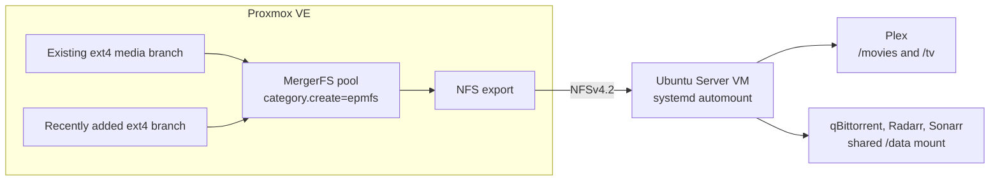

# TJ Resilient Homelab Platform

A documented home-lab infrastructure project built around Proxmox VE, Ubuntu Server, MergerFS, NFSv4.2 and Docker. It explores how a small virtualization host can provide shared media storage and containerized services while keeping storage ownership and application responsibilities explicit.

## Architecture

Proxmox mounts two ext4 media branches and combines them into a MergerFS namespace. It exports that pool over NFSv4.2 to an Ubuntu Server VM. Ubuntu uses systemd automount and provides the mounted paths to Docker services. Plex reads the media libraries; qBittorrent, Radarr and Sonarr share the pool for downloads and library imports.

See [architecture](docs/architecture.md), [storage](docs/storage.md), [operations](docs/operations.md), and the [Mermaid source](diagrams/architecture.mmd).

## Technology stack

- Proxmox VE 9.2 (captured host version)
- Ubuntu Server 24.04.4 LTS VM (captured client version)
- ext4, MergerFS and NFSv4.2
- systemd mount and automount units
- Docker containers: Plex, qBittorrent, Radarr, Sonarr, Overseerr, Prowlarr, FlareSolverr, Uptime Kuma and Portainer

## Engineering decisions

- Keep physical disk mounts and MergerFS on the hypervisor, then provide a network filesystem to the Ubuntu guest.
- Use one pool namespace for shared media paths and container bind mounts.
- Configure `category.create=epmfs`; observed behavior and its limits are discussed in the storage guide.
- Keep application configuration separate from media data where documented, after earlier I/O issues associated with SQLite data on a mechanical disk over NFS.
- Treat MergerFS as namespace aggregation, not RAID or data redundancy.

## Implemented and verified at capture time

- Both media branches and the MergerFS pool were mounted on Proxmox.
- Proxmox exported the pool, and Ubuntu mounted it using NFSv4.2 with a systemd automount.
- Docker inspection showed Plex, qBittorrent, Radarr and Sonarr using pool-backed bind mounts.
- SMART overall health for the existing media branch returned `PASSED`. The SMART query for the recently added media branch through the available USB/SAT path was unsupported; its health is unknown.
- Historical functional tests verified selected media workflows, including imports, Plex playback and a physical hardlink for specific files.

These are bounded observations, not claims of high availability or disaster recovery. Cold-boot resilience has not been tested. Backup restore validation is not established. The root cause of a previous Plex stale network file handle remains unknown. The existing media branch holds historical data, while the recently added media branch was added more recently; their utilization differs for that reason.

## Future work

- Validate mount, NFS and Docker ordering through a planned cold-boot test.
- Investigate the unresolved systemd mount verification warning.
- Obtain SMART data for the recently added media branch using a supported interface.
- Document and perform a controlled backup restore test.
- Preserve evidence and investigate the Plex stale-handle incident if it recurs.

